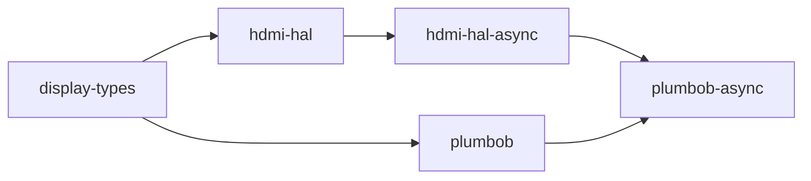

# plumbob-async

[](https://github.com/DracoWhitefire/plumbob-async/actions/workflows/ci.yml)
[](https://crates.io/crates/plumbob-async)
[](https://docs.rs/plumbob-async)
[](LICENSE)
[](https://blog.rust-lang.org/2025/02/20/Rust-1.85.0.html)
[](https://slsa.dev)

Async FRL link training state machine for HDMI 2.1.

`plumbob-async` is the async companion to [`plumbob`](https://crates.io/crates/plumbob).
It runs plumbob's link training state machine — `plumbob::lts::run`, which performs no
I/O itself — over an async `ScdcClient` and an async `HdmiPhy`, `.await`ing each
operation, so training yields to the executor wherever the I/O waits. There is one state
machine for sync and async training: the outcomes, errors and traces are exactly
plumbob's. All shared protocol and training types are re-exported from `plumbob`.

## Usage

```toml
[dependencies]
plumbob-async = "0.1"
```

Implement `ScdcClient` against your async SCDC transport, one method per register
operation (the async counterpart of `plumbob::ScdcClient`; see its documentation for what
each method must guarantee):

```rust
use plumbob_async::{
    CedCounters, FrlConfig, LtpRequests, ScdcClient, SourceTestConfig, UpdateFlags,
};

struct MyScdcClient { /* async I²C / DDC transport */ }

impl ScdcClient for MyScdcClient {
    type Error = MyError;

    // Polled in LTS:2 and LTS:3/LTS:P: await the poll interval (2 ms by default) here.
    async fn read_flt_ready(&mut self) -> Result<bool, MyError> { todo!() }
    async fn read_update_flags(&mut self) -> Result<UpdateFlags, MyError> { todo!() }
    async fn clear_update_flags(&mut self, flags: UpdateFlags) -> Result<(), MyError> { todo!() }
    async fn read_ltp_requests(&mut self) -> Result<LtpRequests, MyError> { todo!() }
    async fn read_source_test_config(&mut self) -> Result<SourceTestConfig, MyError> { todo!() }
    async fn write_config_0_defaults(&mut self) -> Result<(), MyError> { todo!() }
    async fn write_frl_config(&mut self, config: FrlConfig) -> Result<(), MyError> { todo!() }
    async fn read_ced(&mut self) -> Result<CedCounters, MyError> { todo!() }
}
```

Construct an `FrlTrainer` and train over the rates to try, highest first; the sink's
requests for a lower rate step down through the list:

```rust
use display_types::cea861::hdmi_forum::HdmiForumFrl;
use plumbob_async::{FrlTrainer, TrainingConfig, TrainingOutcome};

let mut trainer = FrlTrainer::new(scdc, phy);
let config = TrainingConfig::default();

let rates = [
    HdmiForumFrl::Rate12Gbps4Lanes,
    HdmiForumFrl::Rate10Gbps4Lanes,
    HdmiForumFrl::Rate6Gbps4Lanes,
];

match trainer.train(&rates, &config).await? {
    TrainingOutcome::Success { achieved_rate } => println!("Trained at {achieved_rate:?}"),
    TrainingOutcome::FallbackRequired { reason } => println!("No FRL link: {reason:?}"),
    _ => {}
}
```

The `HdmiPhy` bound on `P` is `hdmi_hal_async::phy::HdmiPhy`. The `FrlConfig`,
`TrainingConfig`, `TrainingOutcome`, `TrainingError`, and all protocol types are
re-exported from `plumbob` and are identical between the sync and async APIs.

## Training procedure

The procedure is plumbob's — LTS:2 (prepare), LTS:3 (train), LTS:P (pass), with LTS:4
(lower rate) on the sink's request and LTS:L (exit to TMDS) before every
`FallbackRequired` — because it is plumbob's code: `FrlTrainer` runs `plumbob::lts::run`
over its async SCDC client and PHY. See
[plumbob's README](https://github.com/DracoWhitefire/plumbob#training-procedure) and
architecture document for the states, the poll and retrain limits, and the per-lane rules.

`FallbackRequired { reason }` means no listed rate trained; `TrainingError` means a hard
I/O failure from the SCDC client or PHY. The two are kept distinct so a caller diagnosing
a failure knows whether it came from the protocol or the bus.

## Diagnostics

Enable the `alloc` feature to get `train_traced` (and `train_at_rate_traced`), which
return a `TrainingTrace` alongside the outcome. The trace and its `TrainingEvent`s are
plumbob's: a sync trace and an async trace of the same sink are identical.

```rust
let (outcome, trace) = trainer.train_traced(&rates, &config).await?;

println!("Outcome: {outcome:?}");
for event in &trace.events {
    println!("  {event:?}");
}
```

## Features

| Feature | Default | Description |
|---------|---------|-------------|
| `std`   | no      | Implies `alloc`; no additional API surface |
| `alloc` | no      | Enables `TrainingTrace`, `train_traced` and `train_at_rate_traced` |

No features are enabled by default.

## `no_std` builds

`plumbob-async` declares `#![no_std]` throughout. The bare crate provides full async
training without an allocator. The `alloc` feature adds `TrainingTrace`, `train_traced`
and `train_at_rate_traced`; `std` implies `alloc`.

```toml
# no_std, no heap
plumbob-async = { version = "0.1" }

# no_std + trace support
plumbob-async = { version = "0.1", features = ["alloc"] }

# std targets
plumbob-async = { version = "0.1", features = ["std"] }
```

No executor is assumed. The traits impose no constraint on which async runtime is used —
Embassy, Tokio, and async-std are all valid implementors.

## Stack position



`plumbob-async` depends on `plumbob` for the state machine and all shared data types,
and on `hdmi-hal-async` for the async `HdmiPhy` trait. It does not depend on any executor
or runtime crate.

## Out of scope

- **The training procedure** — it is `plumbob`'s (`plumbob::lts::run`); this crate
  supplies async I/O to it.
- **Rate fallback policy** — the caller decides which rates to pass to `train` and what
  to do with a `FallbackRequired`.
- **SCDC register decoding** — plumbob-async reads typed values from `ScdcClient` and
  does not decode raw register bytes.
- **PHY vendor sequences** — plumbob-async calls `HdmiPhy` methods; the register
  sequences live in platform PHY backends.
- **Timing and inter-poll delay** — the poll limits in `TrainingConfig` are the only
  timeout mechanism; the interval belongs inside the polled `ScdcClient` methods.
- **Executor dependency** — no runtime crate is in the dependency graph.

## Documentation

- [`doc/architecture.md`](doc/architecture.md) — role, scope, the async trait and
  trainer, and design principles
- [`doc/model.md`](doc/model.md) — the re-exported types and the culvert-async boundary
- [`doc/testing.md`](doc/testing.md) — what the async driver's tests cover

## Verifying releases

Each release is built on GitHub Actions and attested with
[SLSA Build Level 2](https://slsa.dev) provenance. To verify a release
`.crate` against its signed provenance, install the
[GitHub CLI](https://cli.github.com/) and run:

```sh
gh attestation verify plumbob-async-X.Y.Z.crate --repo DracoWhitefire/plumbob-async
```

The attested `.crate` is attached to each
[GitHub release](https://github.com/DracoWhitefire/plumbob-async/releases).

## License

Licensed under the [Mozilla Public License 2.0](LICENSE).
