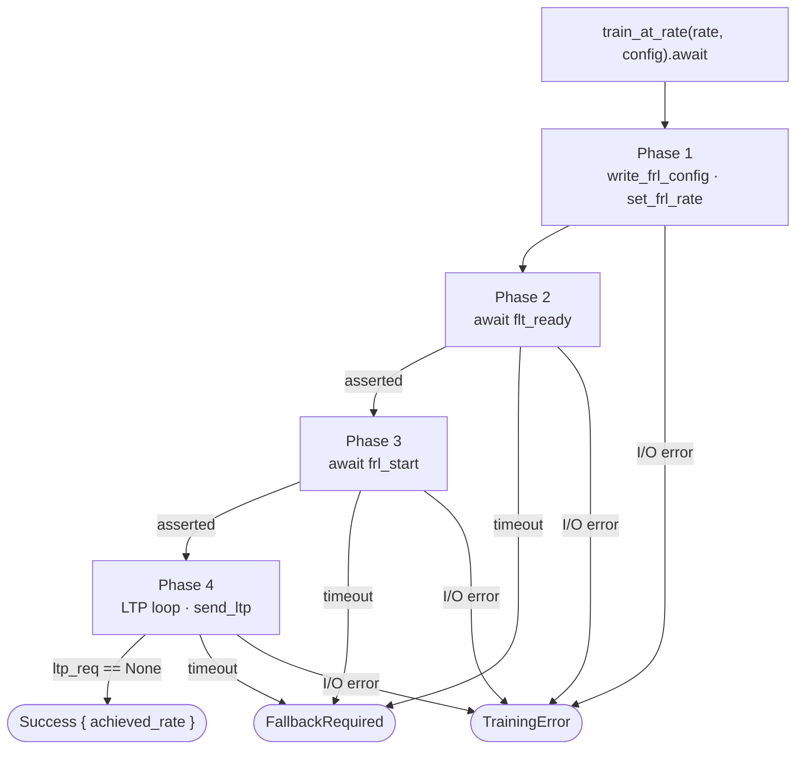
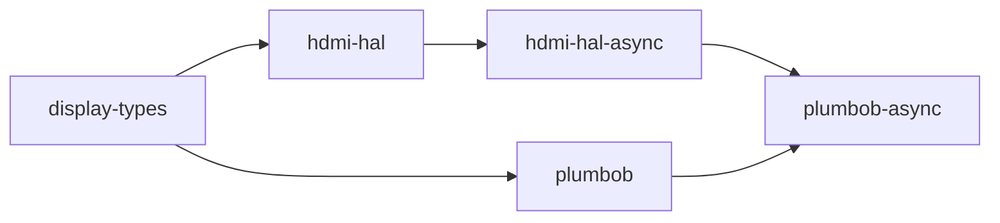

# plumbob-async

[](https://crates.io/crates/plumbob-async)
[](https://docs.rs/plumbob-async)
[](LICENSE)
[](https://blog.rust-lang.org/2025/02/20/Rust-1.85.0.html)

Async FRL link training state machine for HDMI 2.1.

`plumbob-async` is the async companion to [`plumbob`](https://crates.io/crates/plumbob),
following the same design split as `embedded-hal` / `embedded-hal-async`. It mirrors the
four-phase FRL training state machine with `async fn` methods, yielding to the executor
between poll iterations instead of spinning. All shared protocol and training types are
re-exported from `plumbob`; nothing is duplicated.

## Usage

```toml
[dependencies]
plumbob-async = "0.1"
```

Implement `ScdcClient` against your async SCDC transport:

```rust
use plumbob_async::{ScdcClient, CedCounters, FrlConfig, TrainingStatus};

struct MyScdcClient { /* async I²C / DDC transport */ }

impl ScdcClient for MyScdcClient {
    type Error = MyError;

    async fn write_frl_config(&mut self, config: FrlConfig) -> Result<(), MyError> {
        // write rate and FFE level count to SCDC Config_0
        todo!()
    }

    async fn read_training_status(&mut self) -> Result<TrainingStatus, MyError> {
        // read flt_ready, frl_start, ltp_req from SCDC Status_Flags
        todo!()
    }

    async fn read_ced(&mut self) -> Result<CedCounters, MyError> {
        // read per-lane character error counts from SCDC
        todo!()
    }
}
```

Construct an `FrlTrainer` and step down through rates until one succeeds:

```rust
use display_types::cea861::hdmi_forum::HdmiForumFrl;
use plumbob_async::{FrlTrainer, TrainingConfig, TrainingOutcome};

let mut trainer = FrlTrainer::new(scdc, phy);
let config = TrainingConfig::default();

let rates = [
    HdmiForumFrl::Rate12Gbps4Lanes,
    HdmiForumFrl::Rate10Gbps4Lanes,
    HdmiForumFrl::Rate6Gbps4Lanes,
    HdmiForumFrl::Rate3Gbps4Lanes,
];

for rate in rates {
    match trainer.train_at_rate(rate, &config).await? {
        TrainingOutcome::Success { achieved_rate } => {
            println!("Trained at {achieved_rate:?}");
            break;
        }
        TrainingOutcome::FallbackRequired => continue,
    }
}
```

The `HdmiPhy` bound on `P` is `hdmi_hal_async::phy::HdmiPhy`. The `FrlConfig`,
`TrainingConfig`, `TrainingOutcome`, `TrainingError`, and all protocol types are
re-exported from `plumbob` and are identical between the sync and async APIs.

## Training procedure

`train_at_rate` runs all four phases for a single rate attempt and `.await`s each SCDC
and PHY call, yielding to the executor between iterations. `FallbackRequired` means the
link did not converge at this rate; `TrainingError` means a hard I/O failure. The two are
kept distinct so a caller diagnosing a failure knows whether it came from the protocol or
the bus.



## Diagnostics

Enable the `alloc` feature to get `train_at_rate_traced`, which returns a `TrainingTrace`
alongside the outcome. The trace type and its `TrainingEvent` variants are the same as in
`plumbob`; a sync trace and an async trace are directly comparable.

```rust
let (outcome, trace) = trainer.train_at_rate_traced(rate, &config).await?;

println!("Outcome: {outcome:?}");
for event in &trace.events {
    println!("  {event:?}");
}
```

## Features

| Feature | Default | Description |
|---------|---------|-------------|
| `std`   | no      | Implies `alloc`; no additional API surface |
| `alloc` | no      | Enables `TrainingTrace`, `TrainingEvent`, and `train_at_rate_traced` |

No features are enabled by default.

## `no_std` builds

`plumbob-async` declares `#![no_std]` throughout. The bare crate provides the full
four-phase async state machine without an allocator. The `alloc` feature adds
`train_at_rate_traced`; `std` implies `alloc`.

```toml
# no_std, no heap
plumbob-async = { version = "0.1" }

# no_std + trace support
plumbob-async = { version = "0.1", features = ["alloc"] }

# std targets
plumbob-async = { version = "0.1", features = ["std"] }
```

No executor is assumed. The traits impose no constraint on which async runtime is used —
Embassy, Tokio, and async-std are all valid implementors.

## Stack position



`plumbob-async` depends on `plumbob` for all shared data types and on `hdmi-hal-async`
for the async `HdmiPhy` trait. It does not depend on any executor or runtime crate.

## Out of scope

- **Rate fallback policy** — `train_at_rate` returns `FallbackRequired`; the caller
  decides the retry sequence.
- **SCDC register decoding** — plumbob-async reads typed values from `ScdcClient` and
  does not decode raw register bytes.
- **PHY vendor sequences** — plumbob-async calls `HdmiPhy::send_ltp` and `set_frl_rate`;
  the register sequences live in platform PHY backends.
- **Timing and inter-poll delay** — plumbob-async does not insert delays between polls.
  The iteration limits in `TrainingConfig` are the only timeout mechanism; callers that
  need a delay between polls implement it inside their `ScdcClient`.
- **Executor dependency** — no runtime crate is in the dependency graph.

## Documentation

- [`doc/architecture.md`](doc/architecture.md) — role, scope, interface boundaries, and
  design principles

## License

Licensed under the [Mozilla Public License 2.0](LICENSE).
